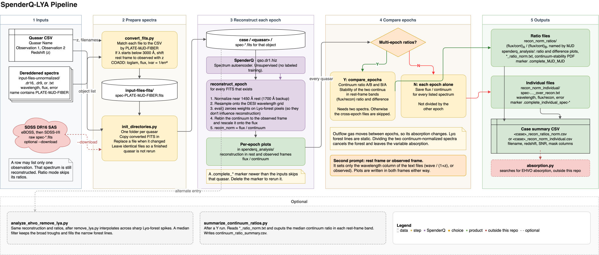

# SpenderQ-LYA

Automated pipeline for finding **extremely high-velocity outflow (EHVO)** absorption in SDSS quasar spectra, including troughs from outflows at v > 20% the speed of light that are buried deep in the Lyman-Alpha (Ly-α) forest.

Only two such forest EHVOs have been identified. The absorption is mixed with the Ly-α forest, so they cannot be identified from a single spectrum by eye. This repo uses [SpenderQ](https://github.com/changhoonhahn/SpenderQ) to reconstruct the unabsorbed continuum, then compares **two epochs of the same quasar**.

**First principles.** Outflow absorption varies between epochs due to the fast-moving nature of the gases in quasar outflows. Ly-α forest lines do not since they stay relatively constant over the timescales in which we observe quasars. Dividing two spectra of the same quasar therefore isolates the variable (outflow) absorption and cancels the Ly-α forest lines. Each spectrum is then divided by its SpenderQ reconstruction, which normalizes it if the underlying continuum is the same in both epochs of observation. Dividing those continuum-normalized spectra by each other amplifies the variable absorption between epochs.

It is built to run on large datasets: one CSV of quasars and two FITS filenames per object, for any SDSS data release that uses the usual `spec-PLATE-MJD-FIBER.fits` naming.

## Pipeline

1. **CSV** — one row per quasar, two observations.
2. **`convert_fits.py`** — converts the dereddened text spectra in `<case>/input-files-unnormalized/` (`.dr16`, `.dr9`, `.txt`) to observed-frame FITS with an `ivar` column, in `<case>/input-files-fits/`.
3. **`init_directories.py`** — one folder per quasar, filled with its dereddened FITS from `input-files-fits/` (or raw SDSS spectra downloaded from SAS with `--download`).
4. **`analyze_ehvo.py`** — SpenderQ reconstruction for each spectrum and analysis plots. It asks `Analyze multi-epoch spectra using ratios? (Y/N)`:
   - **Y** — also compares the two epochs directly: continuum-stability ratios, `(flux/recon)` ratios and differences, and `recon_norm_ratios/` text files.
   - **N** — saves each epoch's `flux / recon` to `recon_norm_individual/` without dividing by another epoch.

Optional:

- **`analyze_ehvo_remove_lya.py`** — same analysis after interpolating sharp Lyα forest spikes (`remove_lya.py`).
- **`multi_epoch/summarize_continuum_ratios.py`** — median continuum ratios in rest-frame bands across a case directory (run after a **Y** analysis; reads `*_ratio_norm.txt`).

## Input CSV

Columns:

```
Quasar Name, Observation 1, Observation 2, Redshift
```

`Observation 1` / `Observation 2` are SDSS spectrum filenames, e.g. `spec-0948-52428-0370.fits`. A row may leave one observation empty; that spectrum is still reconstructed, and ratio mode skips its ratios.

## Setup

```bash
pip install -e .
pip install matplotlib scipy
```

Trained SpenderQ weights (`qso.dr1.hiz*.pt`) are under `src/spenderq/dat/`. The original SpenderQ training and DESI/PICCA scripts in `bin/` and `doc/` are unchanged upstream code.

## Run

From the repo root:

```bash
cd src/spenderq
```

Put the dereddened spectra in `input-files-unnormalized/` next to the CSV. Their filenames must contain `PLATE-MJD-FIBER` (e.g. `6138-57328-0746-dered.dr16`), with columns wavelength, flux, error. Rest-frame files are shifted to the observed frame with the CSV redshift. Then:

```bash
python convert_fits.py path/to/case_dir/list.csv
python init_directories.py path/to/case_dir/list.csv
```

`convert_fits.py` reports any CSV observation with no input file. `init_directories.py` replaces a quasar's existing FITS (e.g. an earlier SAS download) when the converted file differs, so `analyze_ehvo.py` reruns that quasar; identical files are skipped. Both scripts also take explicit folders: `python convert_fits.py CSV INPUT_DIR OUTPUT_DIR` and `python init_directories.py CSV BASE_DIR --fits-dir DIR`.

To use raw SDSS spectra instead, skip `convert_fits.py` and run `python init_directories.py path/to/case_dir/list.csv --download`. It tries SDSS DR16 SAS (eBOSS, then SDSS-I/II) and skips files that are already downloaded.

Next, set `CASE_DIR` and `CSV_PATH` at the top of `analyze_ehvo.py`, then:

```bash
python analyze_ehvo.py
```

Answer `Y` for the epoch-vs-epoch ratio analysis or `N` for individual epochs. Finished quasars are skipped on reruns; delete the `.complete_*` marker in `spenderq_analysis/` to reprocess one.


## Outputs (per quasar)

Under `case_dir/<quasar>/`:

| Path | Contents |
|------|----------|
| `spec-*.fits` | Input spectra: dereddened FITS from `convert_fits.py`, or SAS downloads with `--download` |
| `spenderq_analysis/` | Reconstruction plots (rest + observed) and flux/continuum plots for every epoch. With **Y**, also continuum-ratio and flux/continuum-ratio panels and `*_ratio_norm.txt` |
| `../recon_norm_ratios/` | **Y**: `(flux/cont)_A / (flux/cont)_B` text files, named by MJD. This is the ratio of two continuum-normalized spectra, which highlights variability across separate observations of the same quasar. |
| `../recon_norm_individual/` | **N**: per-epoch `flux / continuum` text files in the observed frame (wavelength, flux/recon, error), named `spec-PLATE-MJD-FIBER_over_recon.txt`. Not divided by any other epoch. |

A case-level summary CSV in the `absorption.py` input format is written in the case directory: `<case>_recon_ratios_norm.csv` (**Y**) or `<case>_recon_norm_individual.csv` (**N**).

## Layout

```
src/spenderq/
  convert_fits.py          # dereddened text spectra → observed-frame FITS with ivar
  init_directories.py      # CSV → quasar folders, filled from input-files-fits/ (or SAS with --download)
  analyze_ehvo.py          # Y/N prompt; runs the ratio or individual-epoch analysis
  reconstruction/          # shared: CSV + FITS input, SpenderQ continuum, flux/recon + absorption CSV output
  plotting/                # shared: per-epoch reconstruction plots, line markers, figure saving
  multi_epoch/             # Y only: epoch-vs-epoch ratios, ratio/difference plots, recon_norm_ratios/ files,
                           #   success criteria (epoch continuum stability per rest-frame band),
                           #   summarize_continuum_ratios.py (case-level summary of those checks)
  spectral_lines.py        # Lyα, Lyβ, ion-line wavelengths
  analyze_ehvo_remove_lya.py
  remove_lya.py            # median-filter Lyα spike cleaning
  continuum_regions.py     # rest-frame band masks
  spenderq.py              # SpenderQ model wrapper (upstream)
  lyalpha.py, desi_qso.py, util.py
```



## SpenderQ

Continuum reconstruction is [SpenderQ](https://github.com/changhoonhahn/SpenderQ) (Hahn et al.): a data-driven spectrum autoencoder that masks absorption and reconstructs the intrinsic quasar spectrum. This repository adds SDSS data ingestion, per-quasar directory layout, and detailed epoch-to-epoch EHVO analysis on top of that model.


